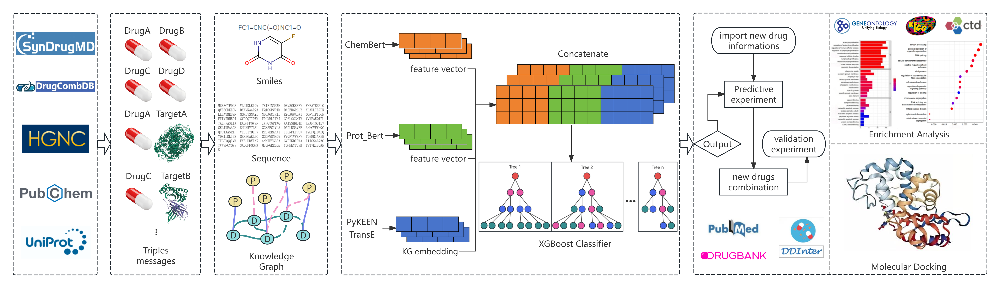

# KGP-DC: Knowledge Graph-Powered Drug Combination Prediction

[](https://www.python.org/downloads/)
[](https://opensource.org/licenses/MIT)

A framework for predicting **recorded drug-combination associations** by
integrating knowledge graphs, pre-trained molecular features and protein
sequence embeddings.

The prediction target is a drug-combination association as it is recorded in
the source database. It is not a measured synergy value, not a clinical
drug-drug interaction and not a safety interaction; the discussion section of
the manuscript states this explicitly and reports the limits of the
evaluation protocol.

## Overview



## Description

The process consists of five main steps: 1. Collect drug-drug combination information and drug-target interaction information from various databases, such as SynDrugMD, as well as from the literature. 2. Further organize the dataset and remove redundant information based on the collected drug CIDs, drug database names, and target IDs. 3. Based on the collected information, construct a knowledge graph and convert the chemical structure (SMILES) information of drugs and the sequence information of target proteins. 4. Utilize the pre-trained models ChemBERTa and ProtT5 to extract feature vectors from drug chemical structure information and corresponding target sequence information, respectively, while employing the TransE model for embedding learning to represent drug-drug combinations. 5. Build an XGBoost model to identify potential drug combinations.

## Project Structure

```
Drug-combination-identification-based-on-Knowledge-Graph/
|-- Database/                   # Source data
|   |-- DDI.csv                 # drug-drug combination triples
|   |-- DTI.csv                 # drug-target interaction triples
|   |-- smiles.csv              # drug -> SMILES
|   `-- targets.csv             # target -> amino-acid sequence
|-- Triples/                    # Knowledge-graph construction and TransE embedding
|   |-- create triples.py
|   |-- get embeddings.py
|   `-- embeddings/             # entity / relation embeddings, mapped triples
|-- Similarity/                 # Drug and combination similarity analysis
|   |-- morgan.py               # Morgan fingerprint extraction
|   |-- sim.py                  # Cosine similarity computation and visualization
|   |-- DB_id_smiles.csv        # DrugCombDB drug SMILES data
|   |-- Syn_id_smiles.csv       # SynDrugMD drug SMILES data
|   `-- complete_analysis.png   # Similarity heatmap and distribution plot
|-- cold_start/                 # Strict unseen-drug evaluation (single-cold and dual-cold)
|   |-- entity_split_data/      # drug-level features and the warm / single / dual splits
|   |-- kg_embedding/           # per-split train-only TransE embeddings
|   |-- single_cold_start/      # split rules for the single-cold regime
|   |-- dual_cold_start/        # split rules for the dual-cold regime
|   `-- warm_start/             # split rules for the pair-level regime
|-- diffierent classifical/     # Earlier classifier comparison and positive/negative ratio study
|-- performance/                # Canonical model and evaluation workspace
|   |-- README.md               # protocol, results and discussion of all experiments
|   |-- requirements.txt
|   |-- baseline_experiments/   # same-protocol comparison against four literature baselines
|   `-- negative_sampling/      # negative-sampling strategy ablation (Euclidean / RMS screening)
|-- requirements.txt
|-- LICENSE
`-- README.md
```

## Dependencies

Use **Python 3.10 or 3.11**. Install all dependencies from the repository root:

```bash
pip install -r requirements.txt
```

The `performance/` workspace carries its own merged environment file,
`performance/requirements.txt`, which additionally documents the exact pins
that produced each reported result set.

Key packages:

| Package      | Version   | Purpose                               |
| ------------ | --------- | ------------------------------------- |
| pykeen       | 1.10.2    | Knowledge graph embedding (TransE)    |
| xgboost      | >=2.1.4   | Drug combination classifier           |
| scikit-learn | 1.3.2     | Metrics and data splitting            |
| rdkit        | >=2023.09 | Morgan fingerprint computation        |
| transformers | >=4.30.0  | ChemBERTa and ProtT5 feature extraction |
| torch        | >=2.0.0   | Deep learning backend                 |

## Usage

### 1. Build Knowledge Graph Triples and Embeddings

```bash
cd triples/
python "create triples.py"
python "get embeddings.py"
```

### 2. Baseline comparison, leakage audit and significance tests

The full protocol is described in `performance/README.md`, Section 1.

```bash
cd performance/baseline_experiments
pip install -r ../requirements.txt

python main.py check                       # validate the split, the folds, the models
python main.py train                       # 5 folds x 5 methods x seed 42
python main.py evaluate                    # results/table.csv
python src/stats_test.py --bootstrap 1000  # results/significance.{csv,md}
python src/audit/leakage_audit.py --json results/leakage_audit.json
python main.py plot                        # results/figures.png
```

### 3. Negative-sampling strategy ablation

```bash
cd performance/negative_sampling
python aed_rms_experiment.py status
python aed_rms_experiment.py audit
python aed_rms_experiment.py prepare
python aed_rms_experiment.py summarize
```

### 4. Single-cold and dual-cold evaluation

The drug pools, the pair splits and the per-split train-only knowledge graphs
are committed under `cold_start/`. The trained models and their metrics are
the next item of work.

### 5. Drug Similarity Analysis

```bash
cd Similarity/
# Generate Morgan fingerprints (if not pre-computed)
python morgan.py

# Compute drug and combination similarity matrices
python sim.py
```

## Similarity Analysis

The `similarity/` module evaluates the redundancy of drug features and drug combination representations across two benchmark datasets (**SynDrugMD** and **DrugCombDB**). The analysis proceeds as follows:

1. **Morgan Fingerprint Extraction** -- Convert drug SMILES strings into 1024-bit Morgan fingerprints (ECFP4) using RDKit.
2. **Drug Similarity Matrix** -- Compute the pairwise cosine similarity matrix for all individual drugs in each dataset.
3. **Drug Combination Features** -- For each known drug pair, concatenate the Morgan fingerprints of the two constituent drugs to form a 2048-dimensional combination feature vector.
4. **Combination Similarity Matrix** -- Compute the pairwise cosine similarity matrix across all drug combination feature vectors using chunked computation for memory efficiency.
5. **Visualization** -- Generate a 2x3 panel figure with the drug-drug similarity heatmap, the combination-combination similarity heatmap and the side-by-side similarity distribution histogram for both datasets.

The resulting heatmaps and histograms reveal the similarity distribution patterns of drugs and their combinations, providing insight into feature redundancy and dataset diversity.

## License

This project is licensed under the MIT License -- see the [LICENSE](LICENSE) file for details.

## Citation

If you use KGP-DC in your research, please cite our work:

```bibtex
@article{kgpdc2026,
  title={KGP-DC: A Framework for Predicting Drug Combinations by Integrating Knowledge Graphs and Pre-trained Features},
  author={Tao Yuan},
  journal={},
  year={2026}
}
```
